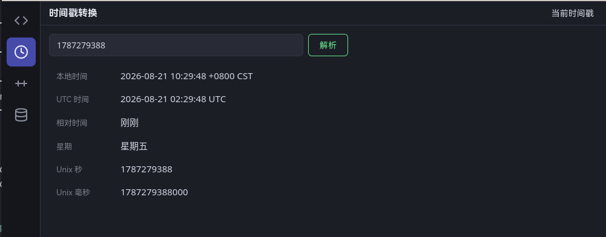

# toolchest

[](https://go.dev)
[](https://v3alpha.wails.io)
[](https://react.dev)
[](./LICENSE)

桌面端开发者工具箱（Linux），Wails v3 + Go + React + TypeScript。

**后端驱动架构**：Go 持有全部配置/状态/内容的权威，前端是纯表现层（通用渲染器）——加一个新工具只需写一个 Go 包 + 一行注册，工具栏操作、配置持久化、侧栏图标全部自动生成。



## 内置工具

- **JSON 工具** — CodeMirror 6 代码视图（行号/折叠/缩进参考线/VS Code 风格搜索）+ 树形视图，格式化/压缩/转义/反转义/中文↔Unicode，缩进设置即时生效并持久化
- **时间戳转换** — 秒/毫秒时间戳与日期字符串互转，多格式结果点击复制
- **SSH 隧道** — 本地端口转发管理，双模式：direct（`ssh -L` 等价）与 exec（远端命令 stdio 中继，适配禁用直连转发的堡垒机如 JumpServer）；卡片列表、密码/代理/公钥三种认证、测试/开启/停止、掉线自动检测（事件推送 + 侧栏提醒灯）；纯 Go 实现，不依赖系统 ssh
- **DBeaver 凭据** — 解密本地 DBeaver workspace 的 `credentials-config.json`，展示全部连接的账号密码（关联 `data-sources.json` 显示连接名/驱动/主机），点击复制

## 安装

### 从源码构建

依赖：Go 1.26+、Node.js 20+、Wails v3 CLI、Linux 平台库（Fedora 示例）：

```bash
sudo dnf install libwebp-devel libjpeg-devel dotnet-core-3.1-devel \
  gtk3-devel webkit2gtk4.1-devel  # Fedora; 其他发行版见 Wails 文档
go install github.com/wailsapp/wails/v3/cmd/wails3@latest

git clone https://github.com/koryfan/toolchest.git
cd toolchest
task install   # 构建并安装到 ~/.local/bin + 桌面图标
```

或手动构建：

```bash
cd frontend && npm install && npm run build && cd ..
go build -o toolchest .
./toolchest
```

## 开发

```bash
wails3 dev          # 开发模式（热重载）
```

改了 Go 服务/类型后重新生成 bindings（必须在仓库根目录）：

```bash
wails3 generate bindings -clean -ts -i
cd frontend && npm run build
```

### 加一个新工具

1. `internal/tools/` 下建子包：定义自己的 `State` + `handlers` 回调表，实现 `domain.Tool` 契约（`Meta/Actions/Invoke/SetContent/State/RunningInBackground`）
2. `internal/toolset/toolset.go` 注册一行
3. 前端 `contentRegistry` 加一行内容组件映射 + 图标

工具栏操作（Button/Menu/Radio 三形态）由 Go 下发的 Action 配置驱动，前端通用渲染；配置自动持久化到 `~/.config/toolchest/config.yaml`。

## 架构

```
main.go                  入口（装配 config/toolset/services）
internal/
├── domain/              工具域核心类型（零依赖）：Tool 契约、Action、Result
├── tools/               工具实现（jsontool/ timetool/ tunneltool/ dbeavertool/）
├── toolset/             工具注册表 + 事件发射 + 生命周期
├── services/            Wails 服务层（AppService：Tools/Invoke/UpdateContent）
├── config/              YAML 持久化：通用容器 + 泛型 Decode[T]
└── transform/           纯转换逻辑（TimeParser）
pkg/strutil/             通用字符串工具
frontend/                React + TypeScript（Vite）
```

设计决策见 [docs/design/](./docs/design/)，踩坑记录见 [docs/knowledge/](./docs/knowledge/)。

## License

[MIT](./LICENSE)
